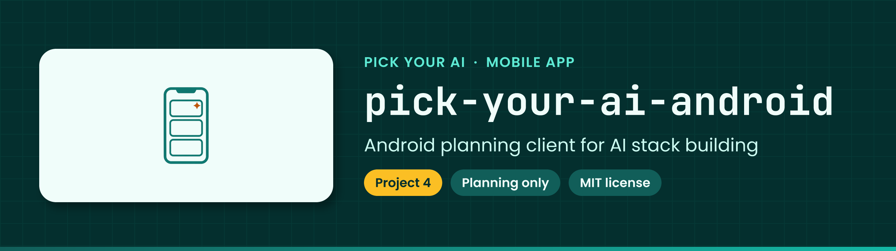

<!-- showcase:banner:start -->

  

<!-- showcase:banner:end -->

<!-- showcase:nav:start -->
**Pick Your AI** · [All repositories](https://github.com/Pick-Your-AI) · [Docs](docs/) · [Contributing](CONTRIBUTING.md) · [Security](https://github.com/Pick-Your-AI/.github/blob/main/SECURITY.md)
<!-- showcase:nav:end -->

# Pick Your AI — Android

<!-- showcase:badges:start -->

<!-- showcase:badges:end -->

<!-- showcase:tagline:start -->
**Android planning client for Pick Your AI; delivery tracked in Project 4.**
<!-- showcase:tagline:end -->

---

## About

The Android planning client for discovering, configuring, checking, costing, comparing and sharing AI stacks. The mobile device is not automatically the inference target.

This repository contains a testable Kotlin/JVM core and an immutable frozen-v1
contract/reference bundle. See [core setup and acceptance evidence](docs/CORE_FOUNDATION.md).
An [opt-in Android diagnostic](docs/ANDROID_PREVIEW.md) validates a bundled synthetic
fixture in an unsigned debug APK. There is no signed installable product,
production backend or release yet.

The [repository scope record](docs/REPOSITORY_SCOPE.md) records the adopted
Kotlin/JVM core and native Android Views preview. The [foundation review package](docs/proposals/README.md)
and [accepted foundation integration record](docs/delivery/android/epics/01.md)
document the reviewed product, client and service decisions. Conditional services,
installed-product validation and release retain their own implementation and
acceptance requirements.

The [data inventory and threat model](docs/security/DATA_INVENTORY_AND_THREAT_MODEL.md)
maps the implemented local preview and planned service flows to privacy/security controls
and verification work. [Android #23's accepted receiving record](docs/delivery/android/work-packages/14.01.md)
records the completed inventory and threat-model design, with explicit implementation
and verification requirements for enabling affected data flows.

- [Delivery Project 4](https://github.com/orgs/Pick-Your-AI/projects/4) and program [Pick-Your-AI/pick-your-ai-android#1](https://github.com/Pick-Your-AI/pick-your-ai-android/issues/1).
- Repository and framework decision: [Pick-Your-AI/pick-your-ai-android#34](https://github.com/Pick-Your-AI/pick-your-ai-android/issues/34). The [accepted native repository/module decision](docs/delivery/android/work-packages/01.03.md) selects the bounded Kotlin core, platform Views and local store; product, device and release requirements remain explicit in the scope record.
- Shared-service decision: [Pick-Your-AI/pick-your-ai-android#35](https://github.com/Pick-Your-AI/pick-your-ai-android/issues/35); reuse canonical services rather than create a competing backend.
- [Repository scope](docs/REPOSITORY_SCOPE.md), [contributing](CONTRIBUTING.md), [agent instructions](AGENTS.md), [MIT license](LICENSE).
- [Local help and public app-bug/evidence-correction reports](SUPPORT.md); private reporting and direct in-app support submission remain unavailable.

## Notes

### Maintainer execution guidance

Use the [platform program prompt](https://github.com/Pick-Your-AI/pick-your-ai-research/blob/da3c6045f84260506bd326bb24ddfa8a7e6a23e8/prompts/mobile/ANDROID.md), [shared rules](https://github.com/Pick-Your-AI/pick-your-ai-research/blob/da3c6045f84260506bd326bb24ddfa8a7e6a23e8/prompts/mobile/SHARED.md), [launch instructions](https://github.com/Pick-Your-AI/pick-your-ai-research/blob/da3c6045f84260506bd326bb24ddfa8a7e6a23e8/prompts/mobile/README.md), and [issue/acceptance/handoff index](https://github.com/Pick-Your-AI/pick-your-ai-research/blob/da3c6045f84260506bd326bb24ddfa8a7e6a23e8/prompts/mobile/INDEX.md). These immutable links reference the reviewed migration guidance from [research PR 111](https://github.com/Pick-Your-AI/pick-your-ai-research/pull/111), merged on 2026-10-18 at `da3c6045f84260506bd326bb24ddfa8a7e6a23e8`. It reconciles transferred issue identities and preserves the original guidance's implementation and acceptance boundaries.

Planning issues now live in `Pick-Your-AI/pick-your-ai-android`. Refresh live assignees, native parents, prerequisites, Project fields, active work and linked PRs before execution. Do not create duplicate tracking or controllers. Repository creation does not launch a campaign or satisfy a delivery acceptance criterion.

The issue migration preserves the original history and native relationships. The reviewed placement ADRs linked from the [repository scope record](docs/REPOSITORY_SCOPE.md) place only their named acceptance records in this Android repository. Other website acceptance-record locations remain authoritative until their own scoped placement decision changes them; Apple filenames retain their separate ADR requirements.

## License

Code and documentation are licensed under the MIT License; see `LICENSE`.
