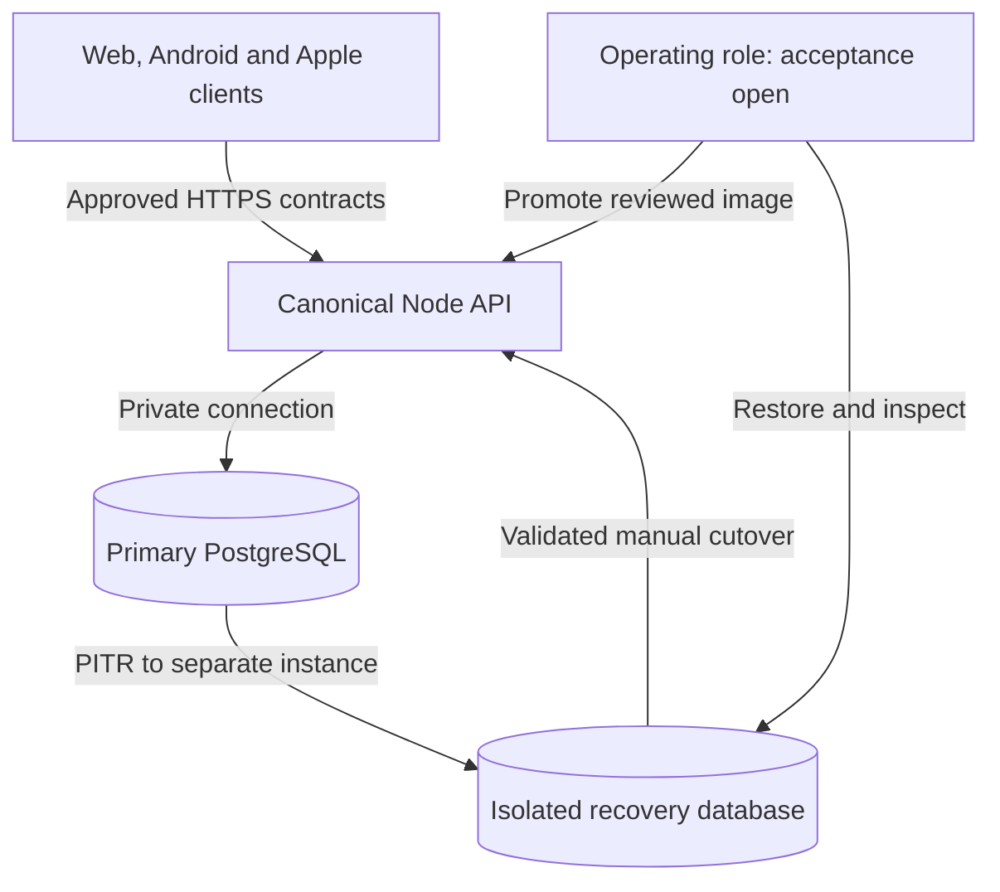

# Shared-service hosting decision for Android #35

Decision date: 2026-10-18. This is the concrete decision artifact for
[Android #35](https://github.com/Pick-Your-AI/pick-your-ai-android/issues/35).
It takes effect through independent product/Android technical receiving review
and normal reviewed merge. The [01.04 receiving record](delivery/android/work-packages/01.04.md)
preserves its three literal criteria and exact inputs;
[ADR 0005](decisions/0005-android-35-acceptance-record.md) governs only that record's
placement.

## Selected boundary

Select **one separately deployed TypeScript/Node API and paid managed PostgreSQL
on Render**, in Frankfurt, for the first canonical shared-service deployment.
Use a Pro workspace, one `1c-2g` web instance and one PostgreSQL 18 `0.5c-1g`
instance, initially 25 GB of storage. The runtime family is Node 24 LTS; pin its
exact supported patch, dependency lock and OCI image digest in the later
implementation's qualified deployment manifest. No image or database already
exists merely because this decision names it. S1–S5 below establish provider
capabilities; the selected sizing and location are engineering choices.

The accountable role is **Shared-service operating owner**, with a separate
recovery custodian and receiving reviewer. No person has accepted those ongoing
roles in the inspected records. O1 therefore remains the explicit operating
acceptance gate permitted by the issue's implementation subtask. The decision
does not assign an existing website or research contributor to on-call work.

The [accepted #24 scope](delivery/android/work-packages/01.02.md) and
[#25 account decision](delivery/android/work-packages/01.05.md) continue to select
**Android's** guest-local J1–J4. Those Android activation decisions govern Android
only. [Apple #21's engineering scope](https://github.com/Pick-Your-AI/pick-your-ai-apple/blob/074ae4bffec6066d3fe6e6a5fe47ab429dde54ed/docs/decisions/issue-21-scope.md)
retains public remote sharing as an intended core journey, qualified through
Apple #23 and the canonical services; local export cannot replace it. Website
#15–#18 can implement an accepted shared capability for another consumer without
waiting for Android remote-feature activation or product completion. Each
consumer retains its own scope and receiving gates. Selecting this host enables
no client feature by itself, and creates no paid resource, public endpoint, DNS
change, service credential or deployment.

The existing GoDaddy website continues to serve its static React/TypeScript
build. A browser can later call an approved HTTPS API; a static JSON mirror can
later distribute specifically approved public artifacts. Neither is private
write authority. The host supplies no Node process or transactional datastore
under the inspected website architecture. Keep the static `dist/` build and its
operations-owned deployment unchanged.

Select `Pick-Your-AI/pickyour.ai/services/planner-api` as the single future server
package, separately built and deployed from the static site. This is a source
placement decision, not an existing directory or a new implementation assignment.
Website #15–#18 retain their actual owners and receiving criteria. Before adding
server code there, its canonical owner/coordinator must review the package and
deployment separation through those existing lanes, including the website's
main-merge production side effect. No server module belongs in Android, Apple,
Research or the leaderboard, and no leaderboard data, grants or database is reused.

## Alternatives and reasons

| Option | Transactions and immutable history | Recovery, location and burden | Disposition |
| --- | --- | --- | --- |
| Existing static GoDaddy site alone | Can serve approved files; cannot perform the required authenticated multi-record commit | Existing frontend deployment is retained; it supplies no database recovery boundary | Insufficient for the stateful service; retain as frontend |
| Render Node container plus managed PostgreSQL | A canonical API can commit revision, expected-head check and idempotency receipt in one PostgreSQL transaction; original artifact bytes remain immutable | Same-region private access, paid PITR into an isolated new instance, and one provider's compute/database controls (S1–S5) | Selected minimum; one API and one database, with the explicit operating gates below |
| Supabase managed PostgreSQL plus the same canonical Node API | PostgreSQL still supports the required transaction model. A direct client SDK would additionally require adoption of its identity/policy semantics; it cannot bypass canonical authority | A separate Node deployment adds a second runtime/control surface. Supabase's documented daily-backup/PITR options and separate object-backup scope remain viable (S8) | Credible alternative, not selected: no demonstrated benefit offsets the extra integration for this bounded service |
| A self-managed Node/PostgreSQL virtual machine | Can implement the same transaction/history model | The project would own OS/database patching, backup scheduling, access controls and restore execution, in addition to application operations (S9 supplies PostgreSQL's backup boundary) | Reject for the first service while no operating person or practiced recovery exists |
| Per-client backends, per-capability microservices, or direct database credentials in clients | Split policy, retries and history across additional trust boundaries | More deployments, migrations and incident responsibilities without a demonstrated scale requirement | Reject for this minimum; later separation needs measured need and coordinated contract review |

The choice is about deployable planning services. API, managed, self-hosted and
hybrid **inference plans** remain the four user modes from #24; they do not require
four backend deployments. Model execution, customer inference, model weights,
raw benchmark uploads and infrastructure provisioning remain outside this first
service. Core T6 evidence, cost coverage and readiness requirements survive that
exclusion and optional T3–T5 deferral.

## Stateful responsibilities and released interfaces

The frozen OpenAPI is v1 `1.0.0`, with relative server `/v1`, **13 paths and 14
operations**. Its global `bearerAuth` requirement covers the reads too. A relative
path is not a deployed URL, and it defines neither token issuance nor a complete
guest/account lifecycle. Do not silently remove that requirement to produce a
public static mirror. Any anonymous distribution is a separately authorized
public artifact channel or an explicitly reviewed contract change.

All rows below are selected destinations or explicit deferrals. None asserts
that a production implementation is already present.

| Responsibility / frozen operation where present | Selected service and persistent boundary | Activation or explicit deferral |
| --- | --- | --- |
| Registry, catalog, graph, rules and rates: `GET /component-kinds`, `/catalog/snapshots/{snapshot_id}`, `/dependencies/{dependency_id}`, `/rulesets/{ruleset_id}?version=…`, `/pricebooks/{pricebook_id}` | API publication/read module; original approved UTF-8 bytes, hashes, exact versions and activation records in PostgreSQL | Website #15/#18, Research #39/#40/#41/#60 acceptance for the specific artifacts; no invented current/latest alias or label field |
| Build creation, private reads and revision updates: `POST /builds`, `GET`/`PUT /builds/{build_id}` | API build module; immutable revision records, current head and principal/object-scoped idempotency receipts in one database transaction | Website #17 and accepted authorization/lifecycle semantics. Android use remains deferred by Android #25; that does not defer canonical implementation for Apple or another accepted consumer |
| Caller and object authorization | The same API checks actual private-read/write authority before accessing each object; separate runtime database role | Token issuance, guest capability, account transfer, expiry and revocation require canonical website #17 / Research #40/#42 authority. Android #62 is Android's implementation/receiving lane, not another client's prerequisite. No authority is inferred from IDs, ownership fields, links or a successful database connection |
| Compatibility: `POST /builds/{build_id}/evaluate` | API evaluation module; exact build revision, selected catalog/graph/rules and approved evidence references accompany retained reports | Qualified canonical evaluator and exact tuple. Missing evidence remains unknown; Research code is not installed as a production runtime by this decision |
| Capacity: `POST /builds/{build_id}/resource-estimates` | API evidence module; retain qualified estimator identity, assumptions and immutable resource-estimate bytes | Website #16 and actual calibration/evidence. Its requested read endpoint still needs #40; do not invent it or infer fit from an uncalibrated number |
| Costs: `POST /builds/{build_id}/estimate-cost` | API cost module; versioned Pricebook, usage assumptions, currency/region and coverage accompany each result | Research #39/#41 qualification. Unknown rates stay unpriced and partial totals remain partial |
| Quality: `POST /builds/{build_id}/quality-runs` | API evidence module; approved run identities and permitted bounded report artifacts | Accept only qualified producer evidence. No benchmark execution, uploaded private dataset or model runner is selected |
| Alternatives: `GET /builds/{build_id}/compatible-options` | API evaluation/read module, bound to the selected build and pinned artifacts | Existing rule and authority requirements apply; an option is not an automatic draft mutation or substitute for unavailable evidence |
| Planning output: `POST /builds/{build_id}/deployment-proposals` | API planning module; retained, version-bound proposal | Produces a proposal only. Execution, cloud purchases and infrastructure changes remain excluded |
| Public sharing, lists, deletion, transfer and revisit | Future lifecycle module in the same API, with approved safe projections and distinct creator/viewer powers | Research #42/#40 and website #17 govern the shared interfaces. Android's conditional J5 does not replace Apple's intended core public sharing under #21/#23. Missing endpoints, retention and revocation semantics require central adoption; full-record URL fragments are not the selected server solution |
| Evidence freshness, source correction and rights | Publication module retains capture/version/source-use decisions separately from the immutable input and activation history | Research #41/#60 remain canonical. No blanket TTL, fabricated independent verification, automatic latest-version replacement or restoration of withdrawn display rights |
| Recovery, deployment and incidents | Operating role manages isolated restore, reviewed image promotion, credential rotation and sanitized service signals | O1–O6 below and canonical service ownership govern the shared service; Android #44/#92 retain their Android receiving inputs. An unattended dashboard is not an accepted response service |

Use PostgreSQL for the first bounded artifact store as well as relational
metadata: preserve the original validated byte sequence and its digest, with
separate indexed metadata. Do not hash a JSONB reserialization and call it the
original source. Published versions are append-only; a transaction changes only
the approved activation pointer. Private builds and their history are never
copied into a public artifact table or mirror. Large payload/object storage is
deferred until measured size, rights, custody and restore consistency justify a
separate store. Imported resource bounds remain those of the approved consumers;
this decision changes no frozen limit or schema.

## Environments, location and custody

The following is the selected target topology. It is not an inventory of deployed
resources. The GoDaddy static host is outside the API/database private network.

| Environment | Data and location decision | Required isolation |
| --- | --- | --- |
| Local development | Existing labelled fixtures and disposable developer PostgreSQL when server work is approved; no production records | No production credential, no automatic remote writes or provider provisioning |
| Staging / recovery qualification | Separate Render environment and database in Frankfurt; synthetic or specifically approved sanitized inputs | Distinct credentials and artifact activation. Pro cross-environment private-network block enabled; no production secret group or database URL |
| Production target | One API and paid database in Frankfurt; private data only after O1–O6 and applicable feature acceptance | Protected environment, explicit cross-environment network block, database external access disabled, scoped runtime credentials and reviewed promotion |

Frankfurt is a deliberate single-region engineering choice, not a claim about
users' residency needs or a legal compliance finding. O2 must record the actual
account, regional availability, backup/support/control-plane locations and
approved data categories before private data enters the service. If that
assessment requires another region, revise this record and qualify migration;
Render does not offer an in-place region change (S5). No current workload or
cross-region latency measurement is claimed.

Render's environment names alone do not isolate traffic. Its private-network
block is an explicit Pro setting; it does not deny public API routes or external
database connections. Repository writers can also modify Blueprint-managed
protected services, so production source/ref and deployment credentials require
their own control (S3). Do not assume that the word `production` or a UI protection
label establishes all of these boundaries.

Select the same-region database internal URL and require TLS without plaintext
fallback. S4 documents self-signed internal certificates and the absence of
`verify-ca`/`verify-full` support there; this is not a claim of verified public-PKI
server identity. Accept and qualify that provider-private-network boundary in O3,
or revise the connection design before activation. Disable the documented
default external allow-all rule. Mobile/browser clients never receive database,
publisher, deploy or backup credentials.

Use environment-scoped provider secret configuration for runtime values, with no
value in source, static bundles, planning records or logs (S6). Give the API a
limited database role; use separate migration, publication and recovery powers.
The operating owner holds provider/account recovery and deployment authority;
the recovery custodian holds the independent encrypted-backup key and access.
Record actual custody and tested rotation, not secret values, in restricted
operating evidence. Avoid request bodies, bearer tokens and private identifiers
in diagnostic output. SQL must be parameterized; S4's slow-query logging requires
the implementation's actual redaction review rather than a promise of no logs.

## Deployment, history and recovery

The deployment input is an independently reviewed source commit/tree, exact OCI
image digest, lockfile and runtime patch, schema migration identity, frozen import
hash and tested configuration names. Bind the HTTP server to the platform's
documented port/interface, configure a generic health check, and withhold healthy
readiness if required configuration, database schema or approved source pins do
not match. S1 describes these host interfaces. Actual base URLs, service IDs,
tokens and health-path implementation are outputs of the later qualified lane,
not example credentials or new frozen product endpoints in this document.

Select deliberate promotion of a qualified digest, rather than automatic
production deployment on every server-source update. Keep the website's existing
automatic static deployment policy untouched. The service operating role and
canonical website operations owner must review any future workflow/CSP/DNS change
through the existing lane. Website `VITE_API_BASE_URL` includes `/v1`, and its
current `connect-src 'self'` requires the actual operations-approved API origin
before cross-origin use. `VITE_BUILD_STORE=http` is not enabled by this record.

Database schema changes use a reviewed expansion/compatibility step before any
later contraction. A prior application image is usable for rollback only while
it can read the current database schema and artifact versions. S7's image rollback
does not restore database contents or every setting/secret. Use immutable image
digests and separately review configuration; do not restore an old database just
to undo an application release.

Select the paid Pro seven-day PITR window as the minimum provider recovery
configuration. A restore creates a separate instance, and S2 excludes recovery
points within ten minutes of the present. That fact is not a guaranteed recovery
point or time objective. Preserve the original instance while validating the
recovery candidate. Also require a daily encrypted logical export under an
independent recovery custodian; provider account/database deletion must not be
the only copy's lifetime boundary. The recovery vault's actual location, access,
key, retention and scheduled mechanism remain O4 inputs. No backup is claimed to
exist or to have been restored.

For qualification, select **15-minute data-loss and four-hour service-restoration
targets** for provider PITR, and a **24-hour export interval** for the independent
copy. These are provisional engineering targets, not provider promises, observed
timings, an on-call agreement or approved retention law. The independent export
has a different possible loss window from PITR. Keep the service unavailable if
the actual restore cannot meet integrity/authority checks; measure both paths
with representative bounded data before promising operational readiness.

Restoring bytes can restore old authorizations too. After any rollback of data,
keep private reads, writes and sharing unavailable until current rights,
revocations, deletions and acknowledged-operation receipts are reconciled. An
older database is not authority to republish withdrawn facts, restore a deleted
account or retry a lost operation as a new write. Any required credential
invalidation/re-issuance follows the accepted canonical authorization mechanism;
this decision invents no client header or token epoch. Missing reconciliation
evidence prevents activation, with the retained original instance and explicit
recovery status available to the operating owner.

## Recorded desk walkthrough

The Android decision agent walked the frozen interfaces, accepted local/remote
scope and S1–S9 on 2026-10-18. These are design checks and identified recovery
requirements. No HTTP request, database transaction, restore, paid service,
Android installation or participant journey was executed for this record.

| Case / states examined | Design result and failure/recovery boundary | Remaining execution |
| --- | --- | --- |
| W1 Static page → private build write | The static host has no write role. Route the later request to the canonical API only after authenticating scoped authority; missing authority leaves it unavailable | Canonical #17 authorization and actual denied/private access tests |
| W2 Authorized save → commit → lost response → retry | Commit revision, expected head and principal/object/idempotency receipt together. Recheck current authority before replaying a result; an authorized retry of the same operation returns its committed result, while changed content under the same key is rejected. Competing expected revisions conflict without duplicate history | Database transaction/concurrency/failure tests and the approved retry/receipt-retention contract; no guessed expiry or deployed invariant asserted |
| W3 Pre-commit failure or uncertain local/remote result → reopen | Never label a pending operation saved. Verify the durable selected head; an uncertain acknowledgment can follow a durable new head, so retaining or blindly replaying an assumed old head is unsafe | Existing Android storage lane retains its Failed/Uncertain semantics; server recovery is independently qualified |
| W4 Good catalog → bad candidate → rollback | Verify complete immutable bytes and source-use decision before pointer promotion. Repoint to an eligible retained version without rewriting history; missing/withdrawn prior rights mean publication remains unavailable | Actual publication/CAS and source-rights tests under website #15 / Research #41/#60 |
| W5 Database loss → PITR candidate → validation → cutover | Restore separately, verify schema, original-byte hashes, revision/head links and idempotency records, reconcile current authority, then change the API connection deliberately. A failed validation leaves the candidate inactive | Measured isolated restore and lost-ack/revocation regression receipts; O4 |
| W6 Database/account deletion or damaged backup → independent export | Provider-only recovery is insufficient for account/database loss. Verify the separately held encrypted export and key, restore into isolation, and declare its actual loss window; never overwrite the only surviving instance | Accepted vault/custodian and an independently executed export-restore drill |
| W7 Server image rollback after schema change | The older image must pass the current-schema compatibility check; otherwise use a reviewed forward repair. Database restore and credential rotation are separate operations | Paired-image/migration and configuration recovery tests; O3/O6 |
| W8 Staging identity, late response, logout or revocation | Distinct environment/principal/object scope prevents cross-environment or cross-user result adoption. A late callback cannot restore retired authority; public viewer rights remain narrower than creator rights | Canonical service and each client's existing selection/lifecycle receiving tests |
| W9 Missing estimate, contradictory facts or expired source permission | Preserve unknown/partial/unavailable and the selected tuple. Neither backup age, a newer snapshot nor HTTP success manufactures compatibility, current rates or reuse permission | Qualified evidence and affected-client receiving acceptance, with optional breadth still excluded |

Desk result: every required stateful responsibility has a destination or explicit
deferral; the three requested topology checks (build transaction, catalog rollback
and database restore) expose concrete failure/activation boundaries. Their
implementation and operational measurements remain unexecuted.

## Cost assumptions and operating gates

Sizing assumptions are a small bounded planning API, no model execution, one
production instance, no HA/read replica, limited approved artifact volume and
separate temporary staging/recovery capacity. Start qualification with a maximum
of ten database connections per API instance, allowing for overlapping deploys
and reserved operating connections; S1's selected database tier allows 100.
This is a connection-budget choice, not throughput evidence. Alert for review
at 80% storage use; do not silently grow paid capacity or discard acknowledged
history to satisfy a budget. Both thresholds are engineering targets.

Monthly planning cost is the sum of the Pro workspace charge, web compute,
database compute, 25 GB storage, staging/recovery instance time, independent
backup storage/execution, egress, optional approved monitoring, tax and any
separately authorized support. A provisional **USD 100–200/month** planning
envelope is an estimate for comparison, not a current provider quote, an accepted
budget or a claim that all usage fits it. The public price page was inspected but
did not yield a complete rendered numeric quote for this exact composition.
O2 requires a dated account/region quote and explicit spending authority before
ordering resources. No cost is assigned to absent inference work or called zero
because its usage is unknown.

| Gate / accountable role | Concrete acceptance still needed before its activation | Current observed state |
| --- | --- | --- |
| O1 Operating owner and recovery custodian | Actual people accept provider billing/admin recovery, deployment/incident response, backup/key custody and handoff availability; name the independent recovery reviewer | No such agreement is supplied by the live assignees or inspected records. Role responsibilities are selected; people and ongoing commitment remain open |
| O2 Account, location and cost | Actual authorized account, Frankfurt capability and approved data categories/locations, provider/backup retention assessment, exact quote and spending authorization | No account, regional legal approval, paid resource or cost commitment is asserted |
| O3 Credential and environment qualification | Distinct app/migration/publication/recovery roles, selected TLS/private-network boundary, denied cross-environment/external access, secret/log review and exercised rotation/recovery | Design specified above; actual controls and credentials unverified |
| O4 Recovery qualification | Accepted independent encrypted vault/custodian, actual retention/scheduler, both restore paths and measured loss/time, schema/hash/head/rights/authority reconciliation | No export, scheduled backup, database or restore exists as a result of this task |
| O5 Canonical service/data adoption | Exact shared contracts, real artifacts and permitted reuse, versioned authority/lifecycle interfaces and the affected consumer's receiving inputs | Frozen v1 remains exact; open central decisions and each client's own scope persist. Another consumer's qualified canonical service does not wait for Android feature or product completion |
| O6 Deployment and operating readiness | Exact image/runtime/migrations, platform health checks, deployment permission, paired rollback test, working sanitized alert destination and actual responder receipt | No deployment, alert response, installed client integration or release acceptance is claimed |

These are explicit downstream operating/implementation gates, not requests for
permission to finish this decision. The independent product/Android review can
accept the complete #35 design and its open operating gate without inventing an
operator. Its acceptance does not qualify any O1–O6 execution by assertion.

## Current primary capability sources

All primary pages below were read on **2026-10-18**. Version/plan labels are those
observed that day; refresh them before implementation/provisioning. A provider
capability is not evidence of this project's configuration or runtime behavior.

| ID | Primary documentation | Bounded factual input used |
| --- | --- | --- |
| S1 | [Render web services](https://render.com/docs/web-services), [compute plans](https://render.com/docs/compute-plans), [Node release table](https://nodejs.org/en/about/previous-releases) | Render supports Node or container web services and health/port configuration. `1c-2g` is 1 CPU / 2 GB; PostgreSQL `0.5c-1g` is 0.5 CPU / 1 GB with 100 connections. Node 24 is LTS. Sizing adequacy remains an estimate |
| S2 | [Render PostgreSQL recovery](https://render.com/docs/postgresql-backups) | Paid databases have PITR; Pro or higher provides a seven-day window, restores create a new instance, and points within ten minutes of now are unavailable. Free databases do not supply that recovery |
| S3 | [Private network](https://render.com/docs/private-network), [projects/environments](https://render.com/docs/projects) | Same-region/workspace private communication; explicit Pro environment block and protected-environment controls with the public-endpoint and Blueprint limitations discussed above |
| S4 | [Render PostgreSQL creation/connection](https://render.com/docs/postgresql-creating-connecting) | PostgreSQL 18 is offered. Internal TLS is self-signed; external access is permissive by default until changed. Database deletion removes its provider backups. Storage and slow-query-log behavior require the stated operating assessment |
| S5 | [Render regions](https://render.com/docs/regions) | Frankfurt is offered; existing services cannot change region in place |
| S6 | [Render variables and secrets](https://render.com/docs/configure-environment-variables) | Runtime configuration/secret files and environment-scoped groups are supported. Values and repository/deployment access still need custody controls |
| S7 | [Render rollbacks](https://render.com/docs/rollbacks) | Retained image rollback has configuration/persistence limits; immutable container digests avoid a mutable-tag assumption |
| S8 | [Supabase database backups](https://supabase.com/docs/guides/platform/backups) | Paid daily backups and separately priced PITR are alternatives; database backups do not include Storage object bytes. No new Supabase price or account is asserted |
| S9 | [PostgreSQL 18 transactions](https://www.postgresql.org/docs/18/tutorial-transactions.html), [logical backup](https://www.postgresql.org/docs/18/backup-dump.html), [Render pricing](https://render.com/pricing) | Transaction and export mechanisms inform the design; application correctness, recoverability and the full account-specific price remain separate evidence |

The [receiving record](delivery/android/work-packages/01.04.md) pins the actual
project sources, prerequisite acceptance, owner readback and handoffs. This file
does not update the strict criterion ledger, issue state, native edges, Project
fields, frozen contracts, application code or any operating configuration.
